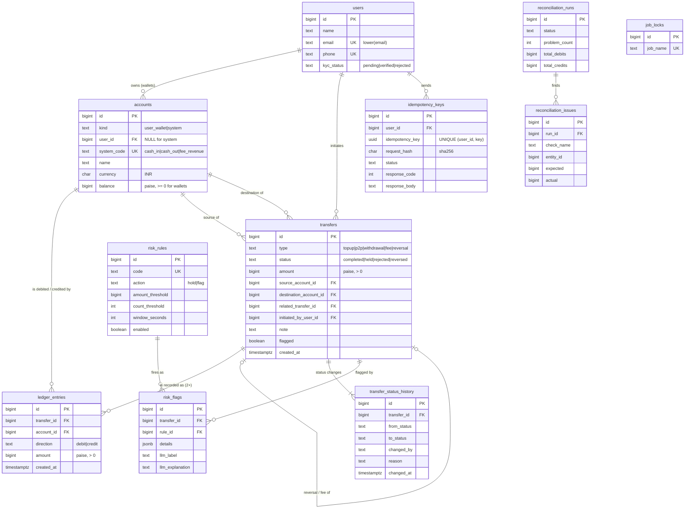

# Schema design (Milestone 1)

The schema was designed from the requirements before any application code. The migrations that build it from an empty database are in [`migrations/`](../migrations):

| File | What it creates |
|---|---|
| `001_schema.sql` | all tables, primary keys, foreign keys, CHECK and UNIQUE constraints |
| `002_guards_and_audit.sql` | triggers: append-only ledger, balanced-transfer check at COMMIT, transfer immutability + legal status moves, audit log |
| `003_indexes.sql` | one index per real query, each commented with the query that pays for it |
| `004_reference_data.sql` | the three system accounts, the fraud rules, the job lock rows |

## 1. Finding the tables: the noun list

Every noun in the requirements, and whether it became a table. Rule used: *if we need to store extra information about it, or many of it relate to one thing, it is a table; if it only describes something else, it is a column.*

| # | Noun (from requirements) | Table? | Why |
|---|---|---|---|
| 1 | platform | no | There is exactly one; nothing to store. |
| 2 | **user** | **`users`** | Has its own attributes (name, email, phone, KYC status) and many wallets point to it. |
| 3 | name, email, phone | column | Describe a user. |
| 4 | KYC status | column (`users.kyc_status`) | One value per user from a fixed set (CHECK constraint). No history required, so no table. |
| 5 | **wallet** | **`accounts`** | Has a balance, an owner, a currency; ledger entries point at it. |
| 6 | currency | column | One per wallet and INR only, so a `CHECK (currency = 'INR')` column, not a currencies table. |
| 7 | **system account** (cash-in, cash-out, fee revenue) | **`accounts`** (same table, `kind = 'system'`) | Behaves exactly like a wallet for bookkeeping: entries debit and credit it. See "why one table" below. |
| 8 | **transfer** | **`transfers`** | The business event: type, status, amount, time, who initiated it. |
| 9 | transfer type, status, amount, created time | column | Describe a transfer. Types and statuses are fixed sets → CHECK constraints. |
| 10 | **ledger entry** (debit / credit) | **`ledger_entries`** | Two or more per transfer, each on exactly one account, each with a direction and amount. |
| 11 | debit / credit | column (`direction`) | Describes an entry. |
| 12 | balance | column (`accounts.balance`) | Cached value derivable from entries; stored for fast reads and locking (see README). |
| 13 | reversal | row in `transfers` (`type = 'reversal'`) | A reversal *is* a transfer; it only needs a pointer to the original (`related_transfer_id`). |
| 14 | **idempotency key** | **`idempotency_keys`** | Needs the request hash, status and saved response; many per user. |
| 15 | request body / response | columns (`request_hash`, `response_code`, `response_body`) | Describe a key. |
| 16 | statement | no | A *query* over ledger entries, not stored data. |
| 17 | **nightly job / report** | **`reconciliation_runs`** | One row per run: start, end, status, counts. |
| 18 | **mismatch** | **`reconciliation_issues`** | Many per run, each with check, id, expected, actual. |
| 19 | (job) lock | **`job_locks`** | One row per job to `SELECT … FOR UPDATE NOWAIT` on. |
| 20 | **fraud rule** | **`risk_rules`** | Thresholds must live in data, not code. |
| 21 | **flag** | **`risk_flags`** | Which rule fired on which transfer, plus the LLM label/explanation. Many-to-many between transfers and rules. |
| 22 | review (held for review, admin) | status value `held` + audit row | "Held" is a transfer status; the admin's decision is recorded in the audit log. No separate reviews table needed. |
| 23 | admin | no | No admin attributes are required; the admin's identity is written into the audit log as text. |
| 24 | question / answer | no | Computed on request from ledger rows; nothing to keep. |
| 25 | **audit log** of status changes | **`transfer_status_history`** | Many rows per transfer: from, to, who, when, why. |

## 2. Attributes

Conventions: plural `snake_case` table names, singular column names, every table has `id BIGINT GENERATED ALWAYS AS IDENTITY PRIMARY KEY`. Money is always `BIGINT` paise.

```
users                    (id, name, email, phone, kyc_status, created_at, updated_at)
accounts                 (id, kind, user_id?, system_code?, name, currency, balance, created_at, updated_at)
transfers                (id, type, status, amount, source_account_id, destination_account_id,
                          related_transfer_id?, initiated_by_user_id?, note?, flagged, created_at)
ledger_entries           (id, transfer_id, account_id, direction, amount, created_at)
transfer_status_history  (id, transfer_id, from_status?, to_status, changed_by, reason?, changed_at)
idempotency_keys         (id, user_id?, idempotency_key, request_method, request_path, request_hash,
                          status, response_code?, response_body?, created_at, completed_at?)
risk_rules               (id, code, description, action, applies_to[], amount_threshold?, count_threshold?,
                          window_seconds?, enabled, updated_at)
risk_flags               (id, transfer_id, rule_id, action, details, llm_label?, llm_explanation?,
                          llm_provider?, explained_at?, created_at)
job_locks                (id, job_name, locked_by?, locked_at?)
reconciliation_runs      (id, triggered_by, status, started_at, finished_at, checks_run, problem_count,
                          total_debits, total_credits, summary, error?)
reconciliation_issues    (id, run_id, check_name, entity_type, entity_id?, expected?, actual?, details, created_at)
```
`?` = nullable.

## 3. Connecting the tables: cardinality

Each relationship was read from both sides, then the foreign key was placed on the "many" side.

| Relationship | Side A → B | Side B → A | Cardinality | Where the FK lives |
|---|---|---|---|---|
| users – accounts | a user has 0..many wallets | a wallet belongs to exactly 1 user; a system account to none | 1 : M (optional) | `accounts.user_id` (NULL for system accounts) |
| transfers – ledger_entries | a transfer has 2..many entries (0 while held/rejected) | an entry belongs to exactly 1 transfer | 1 : M | `ledger_entries.transfer_id` |
| accounts – ledger_entries | an account has 0..many entries | an entry is on exactly 1 account | 1 : M | `ledger_entries.account_id` |
| accounts – transfers | an account is the source of many transfers, and the destination of many | a transfer has exactly 1 source and 1 destination | two 1 : M | `transfers.source_account_id`, `transfers.destination_account_id` |
| transfers – transfers (reversal) | a transfer has 0..1 reversal | a reversal reverses exactly 1 transfer | 1 : 0..1 | `transfers.related_transfer_id` + `UNIQUE … WHERE type = 'reversal'` |
| transfers – transfers (fee) | a withdrawal has 0..1 fee | a fee belongs to exactly 1 withdrawal | 1 : 0..1 | `transfers.related_transfer_id` |
| users – transfers (initiator) | a user starts many transfers | a transfer is started by 0..1 user (NULL for system/seed) | 1 : M | `transfers.initiated_by_user_id` |
| transfers – transfer_status_history | a transfer has 1..many status changes | a change is about exactly 1 transfer | 1 : M | `transfer_status_history.transfer_id` |
| users – idempotency_keys | a user has many keys | a key belongs to 0..1 user (NULL = anonymous/admin) | 1 : M | `idempotency_keys.user_id` |
| transfers – risk_rules | a transfer can trip many rules | a rule fires on many transfers | **M : N** | mapping table **`risk_flags`** (`transfer_id`, `rule_id`, unique together) |
| reconciliation_runs – reconciliation_issues | a run finds 0..many issues | an issue belongs to exactly 1 run | 1 : M | `reconciliation_issues.run_id` |

Worth noticing: **accounts ↔ transfers is really many-to-many** (a transfer touches several accounts, an account takes part in many transfers), and `ledger_entries` is the mapping table that resolves it, carrying its own attributes (`direction`, `amount`). That is exactly what double-entry bookkeeping is.

`job_locks` deliberately has no relationships: it exists only to be locked.

## 4. ER diagram



(GitHub renders this diagram automatically.)

## 5. "Let the database protect you": constraints, not just code

| Rule | How the database enforces it | Proven by |
|---|---|---|
| Entry amounts are positive; direction stored separately | `CHECK (amount > 0)`, `CHECK (direction IN ('debit','credit'))` | `tests/schema-guards.test.js` |
| Each transfer's debits = credits = transfer amount | `CONSTRAINT TRIGGER ledger_entries_balanced … DEFERRABLE INITIALLY DEFERRED` runs at COMMIT | same |
| A user wallet never goes below zero | `CHECK (kind = 'system' OR balance >= 0)` on `accounts` | same, and `scripts/break-it.js` variant A |
| Ledger entries are insert-only | `BEFORE UPDATE OR DELETE` and `BEFORE TRUNCATE` triggers raise an error | same |
| Transfers only change status, only along legal paths, never deleted | `transfers_guard` trigger | same |
| Every status change is audited | `AFTER INSERT OR UPDATE OF status` trigger writes `transfer_status_history`; that table is append-only too | `tests/fraud-and-audit.test.js` |
| Idempotency key unique per user | `UNIQUE NULLS NOT DISTINCT (user_id, idempotency_key)` (PostgreSQL 15+) | same + `tests/idempotency.test.js` |
| A transfer is reversed at most once | `UNIQUE INDEX … (related_transfer_id) WHERE type = 'reversal'` | `tests/fraud-and-audit.test.js` |
| Wallet vs system account shape | `CHECK` that a wallet has a `user_id` and no `system_code`, and vice versa | — |
| Money is never fractional | every amount/balance is `BIGINT` paise; the API rejects non-integers with 400 | `tests/api.test.js` |

### Positive amounts + direction, or signed amounts?

I chose **positive amount + a `direction` column**. Reasons:
- `CHECK (amount > 0)` is a simple, strong constraint. With signed amounts a zero or a sign error would slip through more easily.
- Reports read naturally ("debits", "credits") and the balanced check is `SUM(debits) = SUM(credits)`.
- The cost: computing a balance needs `CASE WHEN direction = 'credit' THEN amount ELSE -amount END`. That is one expression, written once.

Sign convention: an account's balance = credits − debits. Money leaving a wallet is a debit on it; money arriving is a credit. Because every transfer has equal debits and credits, **the sum of every account's balance is always exactly zero**: the cash-in account sits at minus the total money ever topped up, and the wallets plus cash-out plus fee revenue add up to the opposite.

### Indexes and their cost

Every index makes every `INSERT` into that table slower (each index is another B-tree to update, and another thing to WAL-log). `ledger_entries`, the hottest table, has only two secondary indexes: `(account_id, created_at DESC, id DESC)` for statements and `(transfer_id)` for reconciliation and joins. `transfers` has four, each tied to a fraud rule or the review queue, and two of them are partial (`WHERE status = 'completed'`, `WHERE status = 'held'`) so they stay small. Measured timings are in [performance.md](performance.md).
